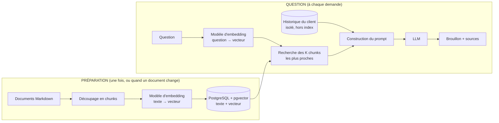

# happiness-rag-poc

POC d'un assistant IA pour une équipe de support client : un collaborateur saisit la question d'un client et obtient un **brouillon de réponse** construit à partir de la documentation métier, de l'historique du client et de règles de ton. L'IA ne répond jamais directement au client.

L'objectif premier du projet est **d'apprendre et de maîtriser un pipeline RAG de bout en bout**, sans framework qui masque son fonctionnement. 
> Les modèles sont locaux (Ollama), la logique d'ingestion, de recherche et d'orchestration est écrite à la main.

> Toutes les données sont fictives. Aucun appel à une API LLM externe : tout tourne en local.

## Principe (RAG, en deux mots)

Un LLM ne connaît pas la documentation interne et risque d'inventer -> Hallucination. 
Plutôt que de lui donner tous les documents, on **retrouve d'abord les quelques passages utiles**, puis on ne lui donne que ceux-là comme base de travail pour générer la réponse. 

Notions :

Ingestion : récupérer les documents (CGV, fiches produits, Confluence).

Parsing : extraire et nettoyer leur contenu.

Chunking : découper les documents en morceaux pertinents. 

Embedding : transformer chaque morceau en vecteur avec un modèle d'embedding.

Vector storage : stocker ces vecteurs dans PostgreSQL + pgvector.

Retrieval : retrouver les morceaux les plus pertinents pour une question.

Augmentation : construire le contexte envoyé au LLM.

Generation : demander au LLM de produire une réponse à partir de ce contexte.

Evaluation : mesurer si les bons documents sont retrouvés et si les réponses sont fiables.

<br>
<br>
Deux pipelines indépendants :



Choix d'architecture importants :
- La documentation est indexée durablement ; **l'historique client n'est jamais mélangé à l'index** et reste strictement isolé par client.
- Les modèles sont **interchangeables** derrière une abstraction, pour pouvoir les comparer.
- L'évaluation (qualité de la recherche, puis de la génération) fait partie du projet, pas d'un bonus final.

## Stack

| Composant | Technologie                                                |
|---|------------------------------------------------------------|
| Backend | Kotlin + Spring Boot                                       |
| Frontend | A déterminer                                               |
| Base de données | PostgreSQL + pgvector                                      |
| LLM local | Ollama + Qwen3 8B                                          |
| Embeddings | embeddinggemma via Ollama                                  |
| Infra locale | Docker Compose (base de données), Ollama installé en natif |

## Prérequis

- **Docker** (Docker Desktop sous Windows, Colima ou Docker Desktop sous macOS). Sous Windows, la virtualisation doit être activée (WSL2).
- **Ollama** installé sur la machine (pour utiliser le GPU).
- JDK et Node : voir les sections backend et frontend quand elles existeront.

## Démarrage rapide

```bash
# 1. Lancer PostgreSQL + pgvector
docker compose up -d
docker compose ps        # le statut doit être "healthy"

# 2. Vérifier pgvector
docker compose exec postgres psql -U postgres -d happiness_poc \
  -c "CREATE EXTENSION IF NOT EXISTS vector;"
```

La base est exposée uniquement sur `127.0.0.1:5433`. Sous PowerShell, écrire chaque commande sur une seule ligne.

## Avancement

- [x] Phase 1 : PostgreSQL + pgvector dans Docker Compose
- [x] Phase 1 : Ollama et appel manuel des deux modèles
- [ ] Phase 1 : squelette Kotlin / Spring Boot
- [ ] Phase 2 : ingestion documentaire (parsing, chunking, embeddings, stockage)
- [ ] Phase 3 : recherche vectorielle
- [ ] Phase 4 : génération avec le LLM (prompt, historique client, sources)
- [ ] Phase 5 : interface Angular
- [ ] Phase 6 : évaluation, comparaison de paramètres et de modèles, métriques de latence

## Mesures

Mesures manuelles via l'API Ollama (`/api/generate`, `stream = false`), un seul essai par ligne. Prompt : « Un client veut renvoyer un album photo reçu abîmé. Que lui répondre en trois phrases ? ». Les chiffres seront refaits proprement (plusieurs essais, démarrage à chaud) quand le jeu de test existera.

| Machine                           | Modèle | Thinking | Tokens générés | Vitesse (tokens/s) | Durée totale |
|-----------------------------------|---|---|---|---|---|
| PC, AMD Radeon RX 7700 XT (12 Go) | qwen3:8b | activé | 335 | 65,4 | 5,2 s |
| PC, AMD Radeon RX 7700 XT (12 Go) | qwen3:8b | désactivé | 51 | 66,6 | 0,8 s |
| Mac M4 Pro (24 Go)                | qwen3:8b | activé | à mesurer | à mesurer | à mesurer |
| Mac M4 Pro (24 Go)                | qwen3:8b | désactivé | à mesurer | à mesurer | à mesurer |
[README.md](README.md)
Constats :
- La vitesse de génération est la même avec ou sans thinking (environ 65 tokens/s) : le thinking ne ralentit pas le modèle, il lui fait générer environ 6,6 fois plus de tokens, donc la réponse arrive environ 6,5 fois plus tard.
- Modèle d'embedding `embeddinggemma` : vecteurs de **768 dimensions**.

## Hors périmètre du premier POC

Connexion réelle à Confluence ou à un outil de support, authentification, multi-tenant, reranking, recherche hybride, agents et tool calling, fine-tuning, déploiement cloud.

## Décisions d'architecture

Les choix importants sont documentés sous forme d'ADR dans [`docs/adr/`](docs/adr/).

## Licence

MIT, voir [LICENSE](LICENSE).
